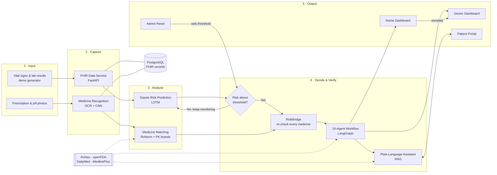
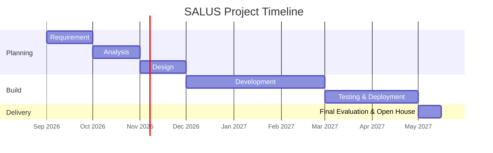

<div align="center">

# 🩺 SALUS

### An AI-Based Patient Safety Platform Using Multiple AI Agents for Early Sepsis Warning and Continuous Medicine Safety Checking

*Watch every patient. Warn early. Recheck every medicine. Explain every alert. The doctor always decides.*

<br/>


**University Institute of Information Technology (UIIT)**
**PMAS-Arid Agriculture University, Rawalpindi**

</div>

---

> [!IMPORTANT]
> **SALUS is an academic decision-support project.** It does **not** diagnose disease or apply any treatment by itself. Every recommendation must be approved by a qualified doctor, and it is **not** connected to any real hospital or real patient data. All demo data is simulated.

---

## 📑 Table of Contents

1. [About the Project](#-about-the-project)
2. [The Problem](#-the-problem)
3. [Literature Review](#-literature-review)
4. [Benchmarking & Gaps Found](#-benchmarking--gaps-found)
5. [Our Solution](#-our-solution)
6. [System Architecture](#%EF%B8%8F-system-architecture)
7. [How SALUS Works (Step by Step)](#-how-salus-works-step-by-step)
8. [RiskBridge: The Core Contribution](#-riskbridge-the-core-contribution)
9. [The 10 AI Agents](#-the-10-ai-agents)
10. [Modules](#-modules)
11. [Intended Users & Permissions](#-intended-users--permissions)
12. [Advantages & Benefits](#-advantages--benefits)
13. [Scope](#-scope)
14. [Tools & Technologies](#%EF%B8%8F-tools--technologies)
15. [Evaluation Plan](#-evaluation-plan)
16. [Mockups](#%EF%B8%8F-mockups)
17. [Repository Structure](#-repository-structure)
18. [Getting Started](#-getting-started)
19. [Software Methodology](#-software-methodology)
20. [Timeline](#-timeline)
21. [Key Concepts We Learn](#-key-concepts-we-learn)
22. [Team](#-team)
23. [References](#-references)

---

## 📌 About the Project

**Patient safety** means protecting people from harm that happens *by mistake* during hospital treatment. Two problems cause a large share of this harm:

- 🦠 **Sepsis**: the body's dangerous reaction to an infection. The chance of survival **falls with every hour of delay**, and the warning signs are spread across many separate readings that a busy nurse or doctor can miss.
- 💊 **Unsafe medicine combinations**: a patient who visits several doctors may end up taking drugs that clash, because **no single doctor ever sees the complete list**.

Hospitals already collect the data needed to catch both problems. Systems that read this data to help staff decide are called **clinical decision support systems**. Deep learning, computer vision, language processing and AI agents now make it possible to turn raw hospital data into **clear and early warnings**.

**SALUS** is a **web-based patient safety system** that:

| | What it does |
|---|---|
| 👁️ | **Watches each patient continuously** |
| ⏱️ | **Gives an early sepsis warning** using a trained LSTM model |
| 🔁 | **Rechecks whether current medicines are still safe** for the patient's changed condition (**RiskBridge**) |
| ✍️ | **Reads handwritten prescriptions** from an image |
| 📷 | **Recognises a medicine** from a photo of its box or a loose tablet |
| 🗣️ | **Explains findings to patients** in ordinary language (English & Urdu) |
| 🤖 | Uses **10 AI agents** to do the watching, checking and alerting automatically |
| 👨‍⚕️ | Keeps the **final treatment decision with the doctor**, always |

It serves **four types of users**: patients, doctors, nurses and administrators. Each one sees only what is useful to them. For demonstration, SALUS runs on a **built-in generator that produces realistic patient readings**, since real hospital records cannot be used.

---

## ❗ The Problem

Hospitals lose patients every day to harm that could have been prevented:

1. **Sepsis is noticed too late.** Survival drops with every hour of delay, and the warning signs are spread across many separate readings.
2. **Unsafe medicine combinations.** A patient sees several doctors and none of them sees the full list of what the patient is taking.
3. **Data sits in separate systems.** Hospitals already collect enough information to catch both problems, but **nobody is watching all of it at the same time**.
4. **Medicines are checked only once**, when prescribed, and never again, even though a patient whose **kidneys or liver begin to fail** can no longer safely take a drug that was completely harmless the day before.
5. **Alerts come without reasons**, which is the recorded cause of staff **ignoring more than 90%** of the warnings they receive.

The problem also reaches ordinary people directly: **patients in Pakistan commonly visit several doctors** and keep no single record of what they take, so they have no way to know whether their own medicines are safe together.

> **Why this project?** The cost of these gaps is measured in **lives, not money**. No existing system found during the literature review solves the whole problem, so SALUS is not a copy of any single product. Known parts that exist in published work (sepsis prediction models and rule-based medicine checking) are **deliberately rebuilt** so that our results can be **compared against published results** instead of simply being claimed.

### 📊 Key numbers

| Number | Finding | Source |
|:---:|---|:---:|
| **67%** | of real sepsis patients were **missed** by the most widely used sepsis tool (38,455 admissions), while it still raised warnings on **18%** of all patients | [1] |
| **>90%** | of medicine warnings (and **77%** of allergy warnings) were **ignored** across 3.5 million prescriptions from 2,872 doctors | [2] |
| **49–96%** | of warnings ignored across 17 studies; **2.3–6%** of ignored warnings later caused **real harm** | [3] |

---

## 📚 Literature Review

| # | Existing System | What it does | ⚠️ Shortcoming |
|---|---|---|---|
| 2.1 | **Epic Sepsis Model** [1] | Most widely used sepsis warning tool, built into the Epic hospital record system and running in hundreds of US hospitals. Scores every patient every 15 minutes. | Closed commercial tool. An outside study found it **missed 67%** of real sepsis cases while warning on 18% of all patients, which causes alert fatigue. Its performance claims were never checked outside the company. |
| 2.2 | **Medicine warnings in hospital prescribing systems** [2], [3] | Check each new medicine against the current list using commercial databases (Lexicomp, Micromedex, First Databank). | Check happens **once**, at ordering time. **>90%** of medicine warnings and **77%** of allergy warnings ignored; 49–96% ignored across 17 studies; 2.3–6% of ignored warnings caused harm. |
| 2.3 | **Public medicine checkers** (Drugs.com, WebMD, Medscape) | Free sites where anyone types a medicine list and gets major / moderate / minor interaction levels. The only tools made for ordinary people. | Know **nothing about the person**: a healthy adult and a patient with failing kidneys get the **same answer**. Only work when the user remembers to open them, so there is **no continuous protection**. |
| 2.4 | **PhysioNet 2019 Sepsis Challenge models** [7] | ~100 international teams predicted sepsis from hourly ICU readings (gradient boosting, LSTM). Results are public and remain the standard reference point. | Research models tested **offline** only: no screens, no accounts, no live data, no deployment. They **ignore the medicines** the patient takes. |
| 2.5 | **NLM RxNav & RxNorm** [23], [24] | Free US National Library of Medicine naming system giving every medicine a standard code; RxNav provides APIs on top. | The online **interaction API was shut down on 2 January 2024**, so systems must use the offline **RxNav-in-a-Box**. Covers **US-approved medicines only**, so many **Pakistani brand names are not recognised**. |

---

## 🏁 Benchmarking & Gaps Found

### Feature comparison of SALUS with existing systems

| Feature | Epic Sepsis Model | Hospital prescribing alerts | Drugs.com / WebMD | PhysioNet 2019 models | RxNav / RxNorm | **SALUS** |
|---|:---:|:---:|:---:|:---:|:---:|:---:|
| Watches patient readings continuously | ✅ | ❌ | ❌ | ❌ | ❌ | ✅ |
| Predicts sepsis using a trained model | ✅ | ❌ | ❌ | ✅ | ❌ | ✅ |
| Checks unsafe medicine combinations | ❌ | ✅ | ✅ | ❌ | 🟡 | ✅ |
| **Rechecks medicines when the patient's condition changes** | ❌ | ❌ | ❌ | ❌ | ❌ | ✅ |
| Reads handwritten prescriptions from an image | ❌ | ❌ | ❌ | ❌ | ❌ | ✅ |
| Recognises a medicine from a photograph | ❌ | ❌ | ❌ | ❌ | ❌ | ✅ |
| AI agents that work together automatically | ❌ | ❌ | ❌ | ❌ | ❌ | ✅ |
| Explains findings to patients in simple words | ❌ | ❌ | 🟡 | ❌ | ❌ | ✅ |
| Question-answering assistant | ❌ | ❌ | ❌ | ❌ | ❌ | ✅ |
| **Shows the reason behind every alert** | ❌ | ❌ | ❌ | ❌ | ❌ | ✅ |
| Patients can use it directly | ❌ | ❌ | ✅ | ❌ | ✅ | ✅ |
| Separate nurse role with alert acknowledgement | ❌ | 🟡 | ❌ | ❌ | ❌ | ✅ |
| Automatic ICU bed and equipment allocation | ❌ | ❌ | ❌ | ❌ | ❌ | ✅ |
| Four user roles with separate access | ❌ | 🟡 | ❌ | ❌ | ❌ | ✅ |
| Admin panel to change alert settings while running | ❌ | 🟡 | ❌ | ❌ | ❌ | ✅ |
| Open system that can be inspected | ❌ | ❌ | ❌ | ✅ | ✅ | ✅ |
| Supports Pakistani medicine names | ❌ | ❌ | ❌ | ❌ | ❌ | ✅ |

<sub>✅ = present · ❌ = absent · 🟡 = partial (present in limited form)</sub>

### 🔍 The 5 gaps SALUS closes

| Gap | Description |
|---|---|
| **Gap 1: Medicines are checked once and never again** | Every existing system checks medicine safety only when the order is written. None looks again, even after the kidneys start failing. |
| **Gap 2: Sepsis and medicine safety are two separate worlds** | Sepsis tools don't know what the patient is taking; medicine tools don't know the patient is getting worse. |
| **Gap 3: Alerts come without reasons** | No system explains *why* it raised an alert, which is the recorded cause of >90% of warnings being ignored. |
| **Gap 4: Patients are left out** | Only public websites serve patients, and those know nothing about the individual person. |
| **Gap 5: Closed tools cannot be checked** | The most used sepsis tool is closed, which is why its poor real-world accuracy went unnoticed for years. |

SALUS keeps what makes existing systems trustworthy: **continuous monitoring, standard medicine codes, separate user roles, and a human doctor approving every treatment decision.**

---

## 💡 Our Solution

SALUS joins **patient monitoring**, **medicine safety** and **plain-language explanation** inside **one connected system**, built in **layers** where each layer feeds the next.

| Layer | Name | What it does |
|:---:|---|---|
| 1 | **Data Service** | Python + FastAPI service receives readings, lab results, prescriptions and notes, converts them to **FHIR**, and stores them in **PostgreSQL**. A built-in **demo generator** sends realistic patient readings as FHIR records. |
| 2 | **Deterioration Prediction** | **LSTM** model trained on **PhysioNet 2019 Sepsis Challenge** data. A **gradient boosting** model and the standard **qSOFA** rule are built as comparison baselines. |
| 3 | **Computer Vision** | Handwriting recognition with a **CNN** reads prescriptions; an **image classifier trained on Pillbox** recognises medicine boxes and loose tablets. |
| 4 | **RiskBridge** | Recalculates the patient's **kidney and liver clearance** and rechecks **every current medicine** against the new state. *(central contribution)* |
| 5 | **Agent Layer** | **LangGraph** workflow of **10 agents** that watch, coordinate, plan, allocate resources, check, explain and verify. |
| 6 | **Language Layer** | Plain-language summaries and a **question-answering assistant (RAG)** that answers **only** from the system's stored records and official drug labels. |

**Why the order matters:** The LSTM runs first and produces a risk score. **Nothing else happens while the score stays below the threshold**, which keeps the system quiet and avoids the alert fatigue that ruins existing tools. Only when the score crosses the threshold does the agent workflow start.

**Why a graph of agents instead of one long prompt?** The work needs **branching**, **memory of earlier steps** and **controlled retries** when a service fails. Splitting the work across agents also makes **each decision auditable**.

Everything is shown through a **React dashboard** with **live WebSocket updates**, protected by **JWT login with four roles**. The administrator can change thresholds, data sources and notification rules **while the system runs, without code changes**. The whole system is packaged with **Docker** and **deployed to the cloud** as a working application, not an offline prototype.

---

## 🏗️ System Architecture


> **Figure 1.** System architecture of SALUS, showing how patient vital signs and medicine images move through data capture, AI risk prediction and the RiskBridge medicine re-check to produce explained alerts for doctors, nurses and patients. The system stays silent until a patient's sepsis risk crosses a set threshold, and every treatment decision stays with the doctor.

<details>
<summary><b>📐 Simplified flow (Mermaid)</b></summary>



</details>

---

## 🔄 How SALUS Works (Step by Step)

```text
 ① Readings arrive  →  ② Validated & stored as FHIR  →  ③ LSTM scores sepsis risk
                                                              │
                         ┌──────────── below threshold ───────┤ (stay quiet, keep watching)
                         │                                    │ above threshold
                         ▼                                    ▼
                    keep monitoring              ④ RiskBridge rechecks EVERY current medicine
                                                              │
                                                 ⑤ 10 agents plan, check, allocate, verify
                                                              │
                                                 ⑥ Alert + reasoning trace + suggested plan
                                                              │
                   ┌──────────────────────┬───────────────────┴──────────────┐
                   ▼                      ▼                                  ▼
            👨‍⚕️ Doctor approves /     👩‍⚕️ Nurse acknowledges /           🧑 Patient gets a
            changes / rejects         escalates (never prescribes)      plain-language summary
```

- 🧾 **Every alert carries a reasoning trace** showing which readings, predictions and medicine records led to it.
- 🔕 **Alerts are grouped and rate-limited**, so one long episode doesn't produce dozens of repeated messages.
- 👨‍⚕️ **Agents only prepare and recommend.** Nothing is applied to a patient until a qualified doctor approves it.

---

## 🌉 RiskBridge: The Core Contribution

> **The gap:** every existing system checks medicine safety **once**, at prescribing time, and **never looks again**.

**RiskBridge** watches the risk score from the sepsis model. When the score crosses the alert threshold, it:

1. **Recalculates the patient's expected kidney and liver clearance** from their new condition.
2. **Re-scores every active medicine** against that *updated* state, not the state at admission.
3. **Flags immediately** any medicine that was safe at admission but has become dangerous, **with a safer alternative** where one exists.
4. **Keeps a full history** of how each medicine's safety rating changed over time, for case review and for research results.

> 💡 **Example:** *Metformin* was fine at admission. Six hours later the patient's kidney function drops as sepsis develops. RiskBridge re-scores Metformin as **unsafe**, explains why, suggests stopping it, and sends the plan to the doctor for approval.

RiskBridge's benefit will be **measured experimentally against a standard rule-based baseline**, not simply claimed.

---

## 🤖 The 10 AI Agents

Built as a connected graph in **LangGraph**:

| # | Agent | Responsibility |
|:---:|---|---|
| 1 | 👁️ **Vitals Watcher** | Reads incoming readings continuously |
| 2 | 🧭 **Case Coordinator** | Takes charge once an alert fires |
| 3 | 💉 **Treatment Planner** | Selects the right antibiotic and dose |
| 4 | 🛏️ **Resource Allocator** | Reserves an ICU bed and infusion pump, notifies the nurse |
| 5 | ✍️ **Prescription Reader** | Handles incoming prescription images |
| 6 | ⚠️ **Interaction Checker** | Looks for unsafe drug combinations |
| 7 | 🌉 **Risk Bridge** | Rechecks medicines against the patient's new condition |
| 8 | 📝 **Advice Writer** | Prepares the recommendation for the doctor |
| 9 | 🗣️ **Patient Explainer** | Writes the simple version for the patient |
| 10 | 🛡️ **Safety Verifier** | Checks the whole plan against official guidelines **before anything is shown** |

---

## 🧩 Modules

<details open>
<summary><b>Module 1: Data Intake & Demonstration Generator</b></summary>

- Receives **vital signs, lab results, prescriptions and clinical notes**.
- Converts each one into **FHIR** and saves it in **PostgreSQL** (built for time-ordered data).
- **Demo generator** produces realistic sequences of vitals and lab observations for simulated patients, sent to the backend exactly as a real monitor would.
- Can generate both **stable** and **gradually deteriorating** patients.
- **Validates input**: rejects missing, repeated or impossible values so no model runs on broken input.
- ⏩ **Adjustable speed**: replay an **8-hour decline in 2 minutes** during a demo.
- All accepted records are stored permanently, giving the models their training history and the assistant its knowledge base.
</details>

<details>
<summary><b>Module 2: Sepsis Prediction Engine</b></summary>

- Trains an **LSTM** on the **PhysioNet 2019 Sepsis Challenge** dataset.
- Inputs: sequences of **heart rate, blood pressure, temperature, respiration rate, oxygen level and lab values**. Sepsis shows as a slow pattern, not one bad number.
- Outputs a **risk score per patient per time step**; this score **triggers everything else**.
- **Baselines:** gradient boosting model + standard **qSOFA** rule, for honest comparison with published results.
- Every prediction is stored with a **confidence value**, so a strong warning can be told apart from a weak one.
- **Evaluated on:** accuracy, sensitivity, specificity, and **hours of early warning before the standard rule would have fired**.
</details>

<details>
<summary><b>Module 3: Prescription Reading & Medicine Recognition</b></summary>

- **Handwritten prescriptions:** image cleaning → OCR supported by a **CNN trained on doctors' handwriting** → extracts **medicine name, dose and frequency**.
- **Medicine photos:** recognises a medicine from its **box or a loose tablet** by **shape, colour and printed markings**, using an image classifier trained on **Pillbox**.
- Names are matched to standard **RxNorm codes**; a **local mapping table** links **Pakistani brand names** to their generic ingredient.
- ✅ **Everything is shown to the user for confirmation before saving**, because handwriting reading is never perfectly reliable.
- The same module serves both a **nurse photographing a ward prescription** and a **patient photographing their own medicine box** at home.
</details>

<details>
<summary><b>Module 4: RiskBridge: Continuous Medicine Safety Engine ⭐</b></summary>

- Watches the risk score from Module 2.
- When the score crosses the alert threshold, **immediately rechecks every current medicine**.
- **Recalculates kidney & liver clearance** from the new condition and **re-scores each medicine** against it.
- Flags medicines that have **become** dangerous, with a **safer alternative** where one exists.
- Keeps a **full history** of how each medicine's safety rating changed over time.
- **Novel:** every existing system checks medicine safety only once at prescribing.
</details>

<details>
<summary><b>Module 5: Multi-Agent Workflow</b></summary>

- **LangGraph** graph containing the **10 agents** listed [above](#-the-10-ai-agents).
- Graph design gives **branching, memory of earlier steps and controlled retries** when an external service fails.
- Alerts are **grouped and rate-limited**.
- Each alert carries a **reasoning trace** listing exactly which readings, predictions and medicine records led to the decision.
- Agents **only prepare and recommend**; nothing is applied until a **qualified doctor approves** it.
</details>

<details>
<summary><b>Module 6: Plain-Language Reports & Assistant</b></summary>

- Automatically writes **short summaries**: what is happening, what the system predicts, which medicines are affected, what action is suggested.
- **Question-answering assistant**, e.g. *"Can I take this medicine with food?"*
- Answers built **only** from the system's stored records and **official drug label sources** (RAG); no invented medical answers.
- **Adjusts explanation level to the reader**: technical for doctors, simple for patients.
- **Every statement carries a reference** to the record it came from.
</details>

<details>
<summary><b>Module 7: Patient Portal</b></summary>

- Photograph a **medicine box or prescription** to add it to a **personal medicine list**.
- **One combined record**, even when medicines come from **several different doctors**.
- Checks the combined list for **unsafe combinations** and explains warnings in ordinary language.
- 🔔 **Medicine reminders** with a record of doses **taken and missed**.
- 👨‍👩‍👧 **Link a family member's account** to manage medicines for an elderly parent or a child.
- Every screen states that the information is **guidance only: consult your doctor before changing anything**.
- Designed for people with **no medical training**: simple words, large clear labels, **Urdu alongside English**.
</details>

<details>
<summary><b>Module 8: Doctor & Nurse Dashboard</b></summary>

- **Doctor:** all assigned patients, live readings, risk scores, alerts **with full reasoning**, and agent recommendations. **Only the doctor approves, changes or rejects** a treatment plan.
- **Nurse:** only **her assigned patients**, bedside alerts, **acknowledge or escalate**; **cannot prescribe or change any medicine**.
- ⚡ **Live updates over WebSocket**: new alerts appear without refreshing.
- 🕒 **Patient timeline**: readings, predictions, medicine changes and alerts in one view (great for shift handover).
- ⏪ **Replay mode**: step back through a patient's decline to see exactly when the system noticed it.
</details>

<details>
<summary><b>Module 9: Login & Role-Based Access</b></summary>

- **Registration, login, email verification, password recovery.**
- **Short-lived access tokens + refresh tokens**, so a stolen token can't be used for long.
- **Four roles:** patient, doctor, nurse, administrator.
- **Every backend route checks the role on the server**, not just by hiding buttons.
- **Salted password hashing**; **rate-limited** login attempts to block brute force.
- **Doctor and nurse accounts must be approved by an administrator** before becoming active.
- 📜 **Audit log** of every login and every important action.
</details>

<details>
<summary><b>Module 10: Administrator Control Panel</b></summary>

- **Live activity:** who is logged in; which alerts were raised, acknowledged or escalated; usage statistics for any period.
- **Approve / reject** doctor and nurse accounts, **suspend users**, review the full action record.
- ⚙️ **Settings while running:** sepsis alert threshold, notification rules, data source settings, with **no code changes**.
- 🩺 **System health:** data arrival rate, external service status, model run time, and recent model accuracy.
- Key idea: the system is **driven by settings, not fixed code**, so hospital policy is changed by an administrator, not a programmer.
</details>

---

## 👥 Intended Users & Permissions

| Role | Who they are | What they can do |
|---|---|---|
| 🧑 **Patient** | Largest and least technical group; the people SALUS ultimately protects | Photograph medicines/prescriptions → one combined list from all doctors · interaction warnings in plain language · reminders · link family accounts · ask the assistant |
| 👨‍⚕️ **Doctor** | Primary decision maker; **only authority to approve treatment** | All assigned patients · live readings & risk score · alerts with full reasoning · RiskBridge warnings with safer alternatives · patient timeline · **approve / change / reject** plans |
| 👩‍⚕️ **Nurse** | At the bedside continuously; usually the first to notice a problem | Assigned patients only · bedside alerts · **acknowledge or escalate** · system-generated tasks (prepare an infusion pump, move patient to a reserved ICU bed) |
| 🛠️ **Administrator** | Keeps the system running correctly and safely | Approve/reject staff accounts · live activity & audit log · change thresholds, notification rules, data sources at runtime · watch system health & model accuracy |

### 🔐 Permission matrix

| Action | Patient | Nurse | Doctor | Admin |
|---|:---:|:---:|:---:|:---:|
| View own medicine list & explanations | ✅ | ❌ | ❌ | ❌ |
| Add medicine by photo | ✅ | ✅ | ✅ | ❌ |
| View assigned patients & live vitals | ❌ | ✅ | ✅ | ❌ |
| Record new readings | ❌ | ✅ | ✅ | ❌ |
| Acknowledge / escalate alerts | ❌ | ✅ | ✅ | ❌ |
| **Approve, change or reject treatment** | ❌ | ❌ | ✅ | ❌ |
| **Prescribe or change medicines** | ❌ | ❌ | ✅ | ❌ |
| Approve staff accounts | ❌ | ❌ | ❌ | ✅ |
| Change alert thresholds & settings | ❌ | ❌ | ❌ | ✅ |
| View system health & audit log | ❌ | ❌ | ❌ | ✅ |

---

## 🌟 Advantages & Benefits

- 🔁 **Medicine safety is checked continuously, not just once.** A drug that becomes dangerous overnight is caught instead of silently missed.
- ⏱️ **Early warning gives doctors time to act.** The model learns the slow pattern of deterioration and warns **hours before** standard hospital rules would.
- 🔕 **Fewer but better alerts.** Silent until the risk crosses a threshold, and every alert carries its reasons.
- 🧑 **Patients are included for the first time.** Photograph medicines, keep one combined list, get plain-language explanations.
- 👨‍⚕️ **The doctor always stays in control.** Agents prepare; doctors approve; nurses acknowledge/escalate but never prescribe.
- 🔓 **Adjustable and open instead of fixed and hidden.** Settings change at runtime; the model and its performance can be inspected by anyone.

---

## 🎯 Scope

### ✅ In scope

- Web-based system built by a **three-member team over ~9 months**.
- Continuous monitoring, early sepsis warning, medicine safety checking, plain-language explanation.
- Accepts readings, lab results, prescriptions and clinical notes → **FHIR** → **PostgreSQL**.
- **Demo data generator** for realistic vitals and lab sequences.
- **LSTM** on PhysioNet 2019 + **gradient boosting** and **qSOFA** baselines.
- Computer vision **only on medicine images**: handwritten prescriptions, medicine boxes, loose tablets.
- **RiskBridge** using updated kidney & liver clearance estimates.
- **10 LangGraph agents.**
- Plain-language summaries + assistant limited to stored records and official drug labels.
- **Four roles**, JWT login, admin panel, React dashboard with WebSocket.
- Medicine data from **local RxNav-in-a-Box**, **openFDA**, **DailyMed**, **MedlinePlus** + **local Pakistani brand-name table**.
- Packaged with **Docker** and **deployed to a cloud platform**.

### ❌ Out of scope

- Connecting to any **real hospital record system** or handling **real patient data**.
- **Diagnosing disease or applying treatment** by itself; a doctor must approve.
- Prediction for **conditions other than sepsis**.
- **X-rays, CT, MRI** or any imaging other than medicine and prescription photos.
- Replacing a **pharmacist, doctor or medical authority**; every patient output says *consult your doctor*.

### 🔮 Future work

- Native mobile apps (Android / iOS)
- Languages beyond **English and Urdu**
- Integration with **commercial hospital software**

---

## 🛠️ Tools & Technologies

### 🖥️ Hardware

| Category | Specification |
|---|---|
| Development machines (×3) | Intel Core i5 / AMD Ryzen 5 or above, 8–16 GB RAM, 256 GB SSD |
| Model training | **Kaggle Notebooks** (free NVIDIA GPU); Google Colab free tier as backup |
| Internet | Minimum 10 Mbps broadband |
| Storage | 40 GB for datasets and medicine images |
| Deployment | Cloud free tier (**Render**), CPU-only, no GPU needed |

> No dedicated GPU is needed. Training runs on free cloud GPUs; the running system uses only the CPU with already-trained models.

### 🧰 Software tools

| Tool | Purpose | Version |
|---|---|---|
| Visual Studio Code | Main code editor | 1.10x |
| Jupyter Notebook | Data exploration and experiments | 7.x |
| Kaggle Notebooks | Free GPU for model training | Cloud |
| Git | Version control | 2.4x |
| GitHub | Code repository and task tracking | Cloud |
| Docker Desktop | Packaging the system | 4.4x |
| PostgreSQL | Database server | 18 |
| pgAdmin 4 | Database management | 9.x |
| Postman | API testing | 11.x |
| Figma | Screen design | Cloud |
| Draw.io | UML, ERD and flow diagrams | 24.x |
| Microsoft Word / PowerPoint | Documents and presentations | Office 365 |
| Overleaf | Research paper writing | Cloud |

### 🗣️ Languages

| Technology | Version |
|---|---|
| Python | 3.13 |
| JavaScript (ES2024) / TypeScript | 5.x |
| HTML / CSS | 5 / 3 |
| SQL (PostgreSQL) | 18 |

### ⚙️ Backend

| Library | Purpose | Version |
|---|---|---|
| FastAPI | Backend API framework | 0.140.x |
| Uvicorn | Server that runs the backend | 0.3x |
| Pydantic | Data checking and settings | 2.x |
| SQLAlchemy | Database access | 2.x |
| Alembic | Database structure updates | 1.x |
| psycopg | PostgreSQL driver | 3.x |
| APScheduler | Scheduled background jobs | 3.x |
| httpx | Calling external services | 0.2x |
| python-jose | Login token handling | 3.x |
| passlib (bcrypt) | Password protection | 1.7.x |
| websockets | Live updates to the dashboard | 12.x |
| pytest | Testing | 8.x |

### 🧠 AI, Machine Learning, Vision & Language

| Library | Purpose | Version |
|---|---|---|
| PyTorch | LSTM and CNN model training | 2.x |
| scikit-learn | Gradient boosting baseline, metrics | 1.x |
| NumPy | Number handling | 2.x |
| Pandas | Table and time-series handling | 2.x |
| OpenCV | Cleaning prescription and medicine images | 4.x |
| Tesseract OCR | Reading text from prescription images | 5.x |
| Ultralytics | Medicine box and tablet detection | 9.0.x |
| Matplotlib | Charts for results and the paper | 3.x |
| LangGraph | Connecting the ten agents | 1.2.x |
| LangChain | Language model tools | 1.x |
| ChromaDB | Storage for the assistant's knowledge | 1.x |
| sentence-transformers | Turning text into searchable form | 3.x |
| Groq Python SDK | Language model, runs in the cloud | Latest |
| Google Gemini SDK | Backup language model | Latest |

### 🎨 Frontend

| Library | Purpose | Version |
|---|---|---|
| React | User interface | 19.2.x |
| Vite | Build tool | 7.x |
| Node.js | Frontend runtime | 24 LTS |
| Tailwind CSS | Styling | 4.1.x |
| Recharts | Charts for vitals and risk scores | 2.x |
| Socket.IO Client | Live alerts on screen | 4.x |
| Axios | Talking to the backend | 1.x |

### 🌐 Data Sources & APIs

| Source | Provides | Access |
|---|---|---|
| RxNav-in-a-Box (NLM) | Medicine codes and unsafe combinations, **runs locally** | Free |
| RxNorm API (NLM) | Standard medicine codes and name matching | Free |
| openFDA API | Official medicine labels, side effects, warnings | Free, key needed |
| DailyMed API | Full official medicine label text | Free |
| MedlinePlus Connect | Medicine information written for ordinary people | Free |
| Groq API | Language model for the agents | Free tier |
| Gemini API | Backup language model | Free tier |

### 🗂️ Datasets

| Dataset | Used for | Access |
|---|---|---|
| PhysioNet 2019 Sepsis Challenge | Training and testing the sepsis model | Free, open |
| NLM Pillbox image dataset | Training medicine and tablet recognition | Free |
| IAM Handwriting Database | Training handwriting recognition | Free for research |
| Local Pakistani medicine mapping table | Matching local brand names to generic drugs | Built by the team |

### 🚀 Deployment

| Tool | Purpose | Version |
|---|---|---|
| Docker | Packaging the system | 27.x |
| GitHub Actions | Automatic testing | Cloud |
| Render | Backend hosting | Cloud |
| Vercel | Frontend hosting | Cloud |
| Neon (PostgreSQL) | Cloud database, free tier | PostgreSQL 18 |

> **Note on versions:** current stable versions as of September 2026. Exact versions will be pinned in `requirements.txt` and `package.json` when development begins, so all three machines run the same setup.

---

## 📏 Evaluation Plan

| What | How it is measured | Compared against |
|---|---|---|
| **Sepsis prediction** | Sensitivity, specificity, precision, recall, AUC (accuracy alone is misleading on imbalanced data) | Gradient boosting baseline, **qSOFA** rule, published **PhysioNet 2019** results |
| **Early warning** | **Hours of warning before the standard rule would have fired** (the clinically meaningful measure) | qSOFA |
| **RiskBridge** | Medicines correctly flagged after the patient's condition changes | Standard **rule-based**, check-once baseline |
| **Prescription & pill recognition** | Recognition accuracy with confidence scores, plus human confirmation | — |
| **Assistant** | Every answer grounded in and referenced to a stored record or official label | Official medicine labels & guidelines |
| **System** | Automated tests (pytest, GitHub Actions), role-access tests, live alert latency | — |

> ⚠️ Time-ordered data is **never shuffled** before splitting into train/test, so the model can't "see the future" and report falsely good results.

---

## 🖼️ Mockups

| | |
|:---:|:---:|
|  |  |
| **14.1 Doctor Dashboard**: patients ranked by sepsis risk, live vital trends, critical alert banner, pending approvals *(Modules 2, 5, 8)* | **14.2 Alert Detail with RiskBridge Recheck**: every medicine's safety before & after, reasoning trace, agents that ran, approval controls *(Modules 4, 5, 8)* |
|  |  |
| **14.3 Nurse Station: My Beds**: bedside alert with acknowledge / escalate only, assigned beds with risk levels, shift task list *(Modules 5, 8, 9)* | **14.4 Bed Detail & Vital Sign Entry**: 12 hours of readings, manual entry form, doctor's instructions, shift timeline *(Modules 1, 8)* |
|  |  |
| **14.5 Patient Home**: combined medicine list from three doctors, plain-language warning, next dose reminder, family members, assistant *(Modules 6, 7)* | **14.6 Medicine Recognition by Photograph**: recognised medicine, local brand → generic match, plain-language info, automatic safety check *(Modules 3, 7)* |
|  |  |
| **14.7 Administrator Overview**: system statistics, staff awaiting approval, service health, adjustable thresholds, live activity log *(Modules 9, 10)* | **14.8 AI Agent Monitor**: all ten agents with status and speed, latest workflow run, weekly model accuracy, agent switches *(Modules 5, 10)* |

---

## 📁 Repository Structure

> Planned layout. This will be updated as development progresses.

```text
salus/
├── backend/                  # FastAPI application
│   ├── app/
│   │   ├── api/              # REST + WebSocket routes (role-checked on the server)
│   │   ├── auth/             # JWT, refresh tokens, password hashing, RBAC
│   │   ├── fhir/             # FHIR conversion & validation
│   │   ├── models/           # SQLAlchemy models
│   │   ├── services/         # RxNav, openFDA, DailyMed, MedlinePlus clients
│   │   ├── riskbridge/       # Clearance estimation & medicine re-scoring
│   │   ├── agents/           # LangGraph graph + 10 agents
│   │   ├── assistant/        # RAG pipeline (ChromaDB)
│   │   └── generator/        # Demo patient data generator
│   ├── alembic/              # Database migrations
│   └── tests/                # pytest
├── ml/
│   ├── sepsis/               # LSTM, gradient boosting, qSOFA baseline
│   ├── vision/               # Handwriting OCR + pill classifier
│   └── notebooks/            # Exploration & experiments
├── frontend/                 # React + Vite + Tailwind
│   └── src/
│       ├── pages/            # doctor / nurse / patient / admin
│       ├── components/
│       └── services/         # Axios + Socket.IO client
├── data/
│   └── pk_brand_map.csv      # Pakistani brand → generic ingredient table
├── docs/
│   ├── diagrams/             # Architecture, timeline
│   ├── mockups/              # UI mockups
│   └── poster/               # FYP poster
├── docker-compose.yml
├── .github/workflows/        # GitHub Actions CI
└── README.md
```

---

## 🚀 Getting Started

> 🚧 **The project is in development.** These steps describe the planned setup and will be finalised once the first release is ready.

### Prerequisites

- **Docker Desktop** 4.4x+ and **Docker Compose**
- **Python 3.13** and **Node.js 24 LTS** (for local development without Docker)
- **Git**
- Free API keys: **openFDA**, **Groq**, **Gemini** (backup)

### 1. Clone

```bash
git clone https://github.com/<your-org>/salus.git
cd salus
```

### 2. Configure environment

```bash
cp .env.example .env
```

```env
# Database
DATABASE_URL=postgresql+psycopg://salus:salus@db:5432/salus

# Auth
JWT_SECRET=change-me
ACCESS_TOKEN_MINUTES=15
REFRESH_TOKEN_DAYS=7

# AI & external services
GROQ_API_KEY=
GEMINI_API_KEY=
OPENFDA_API_KEY=
RXNAV_URL=http://rxnav:4000

# Alerting
SEPSIS_ALERT_THRESHOLD=0.75
```

### 3. Run everything

```bash
docker compose up --build
```

| Service | URL |
|---|---|
| Frontend | http://localhost:5173 |
| Backend API docs | http://localhost:8000/docs |
| RxNav-in-a-Box | http://localhost:4000 |

### 4. Start the demo generator

```bash
# Replays an 8-hour patient decline in about 2 minutes
docker compose exec backend python -m app.generator --patients 8 --speed 240
```

### 5. Run tests

```bash
docker compose exec backend pytest
```

---

## 🔁 Software Methodology

SALUS follows the **Iterative and Incremental Development Model**:

- 🧱 The system breaks naturally into **ten fairly independent modules** that can be built and joined one at a time, so **a working part exists early**.
- 🔬 The **ML, computer vision and agent parts** can't be fully planned in advance; their accuracy only becomes clear through **repeated cycles of training, testing and improving**.
- 👥 Suits a **three-member team**: members build different parts in parallel while a working version is always ready.
- 📄 Unlike purely agile approaches, it still leaves room for **formal documents (SRS, design document)**, and its staged deliverables match the university's **evaluation points**.

---

## 📅 Timeline

| Phase | Period |
|---|---|
| 📝 Requirement | September 2026 |
| 🔍 Analysis | October 2026 |
| 📐 Design | November 2026 |
| 💻 Development | December 2026 – February 2027 |
| 🧪 Testing and Deployment | March – April 2027 |
| 🎓 Final Evaluation and Open House | 1 – 15 May 2027 |



---

## 🎓 Key Concepts We Learn

| # | Concept | Why it matters in SALUS |
|:---:|---|---|
| 1 | **RNNs & LSTM** | Turn monitoring into a sequence problem; never shuffle time-ordered data before splitting |
| 2 | **Time-series handling** | Resampling, gap filling, sliding windows, rate-of-change features |
| 3 | **Class imbalance** | Accuracy is misleading; use sensitivity, specificity, precision, recall, AUC, weighted loss, resampling |
| 4 | **CNNs & transfer learning** | Recognise medicine boxes and tablets from a small dataset |
| 5 | **OCR & handwriting recognition** | Deskewing, thresholding, noise removal; always show confidence and get human confirmation |
| 6 | **Retrieval-Augmented Generation** | Chunk, embed, retrieve and force answers only from given documents |
| 7 | **AI agents & multi-agent systems** | LangGraph shared memory, conditional paths, loops, controlled retries |
| 8 | **Clinical decision support & human oversight** | Recommend, never act; alert fatigue; alerts with reasons get trusted |
| 9 | **FHIR** | International health data standard, ready for real hospital integration later |
| 10 | **Pharmacokinetics basics** | Kidney & liver clearance, the medical foundation of RiskBridge |
| 11 | **Login security & RBAC** | Server-side authN/authZ, access/refresh tokens, salting, SQL injection & XSS defence |
| 12 | **WebSocket** | Push alerts instantly; reconnects; no duplicate messages |
| 13 | **Asynchronous programming** | `async`/`await` for readings, external APIs and agents at once; race conditions |
| 14 | **Containerisation & automated testing** | Dockerfiles, Docker Compose, CI pipelines |
| 15 | **Research method & honest evaluation** | Fair baselines (qSOFA); hours of early warning as the key measure |

---

## 👨‍💻 Team

| Name | Registration No. | Email |
|---|---|---|
| **Habib Ur Rahman** | 23-Arid-503 | habibbuneri343@gmail.com |
| **Zehra Nisar** | 23-Arid-617 | zehranisar75@gmail.com |
| **Alishba Khalid Khan** | 23-Arid-484 | alishbakhaan2856@gmail.com |

**Supervisor:** Mr. Muhammad Azher
**Class:** BS CS 7 · Section A · Morning
**Institute:** University Institute of Information Technology, PMAS-Arid Agriculture University Rawalpindi

<div align="center">


</div>

---

## 📖 References

<details>
<summary><b>Existing systems & clinical evidence</b></summary>

1. A. Wong et al., "External Validation of a Widely Implemented Proprietary Sepsis Prediction Model in Hospitalized Patients," *JAMA Internal Medicine*, vol. 181, no. 8, pp. 1065–1070, 2021, doi: 10.1001/jamainternmed.2021.2626.
2. T. Isaac et al., "Overrides of Medication Alerts in Ambulatory Care," *Archives of Internal Medicine*, vol. 169, no. 3, pp. 305–311, 2009.
3. H. van der Sijs, J. Aarts, A. Vulto, and M. Berg, "Overriding of Drug Safety Alerts in Computerized Physician Order Entry," *JAMIA*, vol. 13, no. 2, pp. 138–147, 2006.
4. M. Singer et al., "The Third International Consensus Definitions for Sepsis and Septic Shock (Sepsis-3)," *JAMA*, vol. 315, no. 8, pp. 801–810, 2016.
5. L. Evans et al., "Surviving Sepsis Campaign: International Guidelines for Management of Sepsis and Septic Shock 2021," *Critical Care Medicine*, vol. 49, no. 11, pp. e1063–e1143, 2021.
6. C. W. Seymour et al., "Time to Treatment and Mortality During Mandated Emergency Care for Sepsis," *NEJM*, vol. 376, no. 23, pp. 2235–2244, 2017.
</details>

<details>
<summary><b>Machine learning for sepsis prediction</b></summary>

7. M. A. Reyna et al., "Early Prediction of Sepsis From Clinical Data: The PhysioNet/Computing in Cardiology Challenge 2019," *Critical Care Medicine*, vol. 48, no. 2, pp. 210–217, 2020.
8. A. L. Goldberger et al., "PhysioBank, PhysioToolkit, and PhysioNet," *Circulation*, vol. 101, no. 23, pp. e215–e220, 2000.
9. S. Hochreiter and J. Schmidhuber, "Long Short-Term Memory," *Neural Computation*, vol. 9, no. 8, pp. 1735–1780, 1997.
10. T. Chen and C. Guestrin, "XGBoost: A Scalable Tree Boosting System," in *Proc. 22nd ACM SIGKDD*, 2016, pp. 785–794.
11. L. Breiman, "Random Forests," *Machine Learning*, vol. 45, no. 1, pp. 5–32, 2001.
</details>

<details>
<summary><b>Computer vision & language processing</b></summary>

12. J. Redmon, S. Divvala, R. Girshick, and A. Farhadi, "You Only Look Once: Unified, Real-Time Object Detection," in *Proc. CVPR*, 2016, pp. 779–788.
13. K. He, X. Zhang, S. Ren, and J. Sun, "Deep Residual Learning for Image Recognition," in *Proc. CVPR*, 2016, pp. 770–778.
14. R. Smith, "An Overview of the Tesseract OCR Engine," in *Proc. 9th ICDAR*, 2007, pp. 629–633.
15. U.-V. Marti and H. Bunke, "The IAM-Database: An English Sentence Database for Offline Handwriting Recognition," *IJDAR*, vol. 5, no. 1, pp. 39–46, 2002.
16. P. Lewis et al., "Retrieval-Augmented Generation for Knowledge-Intensive NLP Tasks," in *NeurIPS*, vol. 33, 2020, pp. 9459–9474.
17. A. Vaswani et al., "Attention Is All You Need," in *NeurIPS*, vol. 30, 2017, pp. 5998–6008.
18. S. Yao et al., "ReAct: Synergizing Reasoning and Acting in Language Models," in *Proc. ICLR*, 2023.
</details>

<details>
<summary><b>Books</b></summary>

19. I. Goodfellow, Y. Bengio, and A. Courville, *Deep Learning*. MIT Press, 2016.
20. A. Géron, *Hands-On Machine Learning with Scikit-Learn, Keras and TensorFlow*, 3rd ed. O'Reilly Media, 2022.
21. I. Sommerville, *Software Engineering*, 10th ed. Pearson Education, 2015.
22. E. H. Shortliffe and J. J. Cimino, Eds., *Biomedical Informatics: Computer Applications in Health Care and Biomedicine*, 5th ed. Springer, 2021.
</details>

<details>
<summary><b>Medicine data sources & standards</b></summary>

23. U.S. National Library of Medicine, "RxNorm Overview." https://www.nlm.nih.gov/research/umls/rxnorm/overview.html
24. U.S. National Library of Medicine, "RxNav-in-a-Box." https://lhncbc.nlm.nih.gov/RxNav/applications/RxNav-in-a-Box.html
25. U.S. Food and Drug Administration, "openFDA Drug API." https://open.fda.gov/apis/drug/
26. U.S. National Library of Medicine, "DailyMed." https://dailymed.nlm.nih.gov/dailymed/
27. U.S. National Library of Medicine, "MedlinePlus Connect." https://medlineplus.gov/connect/overview.html
28. U.S. National Library of Medicine, "Pillbox — Retired Resource and Final Dataset." https://www.nlm.nih.gov/databases/download/pill_image.html
29. HL7 International, "FHIR Release 5 Specification." https://hl7.org/fhir/
</details>

<details>
<summary><b>Software documentation</b></summary>

30. S. Ramírez, "FastAPI Documentation." https://fastapi.tiangolo.com/
31. LangChain Inc., "LangGraph Documentation." https://langchain-ai.github.io/langgraph/
32. Meta Open Source, "React Documentation." https://react.dev/
33. PostgreSQL Global Development Group, "PostgreSQL 18 Documentation." https://www.postgresql.org/docs/18/
34. Ultralytics, "YOLO Documentation." https://docs.ultralytics.com/
</details>

<sub>Online sources accessed September 2026.</sub>

---

<div align="center">

**SALUS**: *Latin for "safety" and "well-being".*

Made with ❤️ at **UIIT, PMAS-Arid Agriculture University Rawalpindi**

⚠️ *For academic and demonstration use only. Not a medical device. Always consult a qualified doctor.*

</div>
